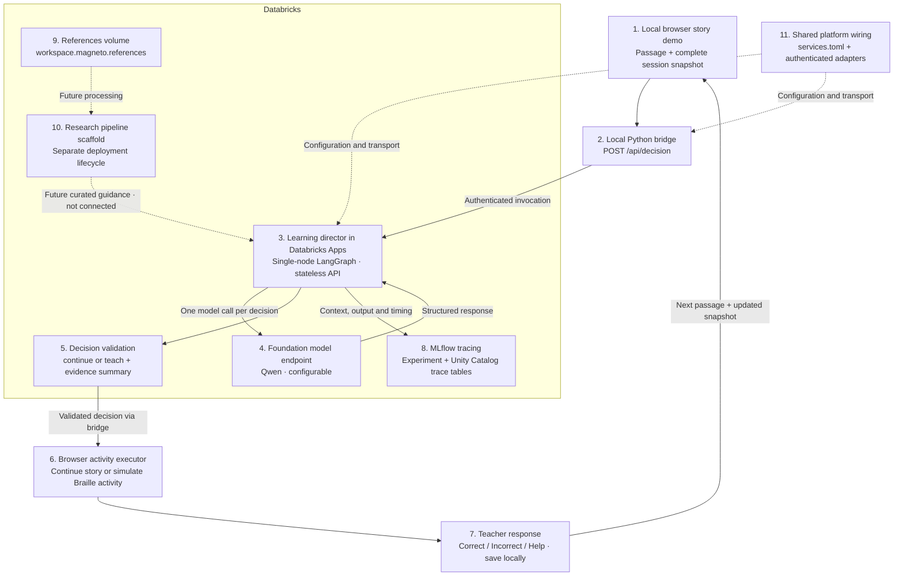

# Databricks workloads

Start here before changing cloud code. These workloads share a repository, not a deployment lifecycle.

| Directory | Owner/responsibility | Deployment |
| --- | --- | --- |
| `platform/` | Shared service wiring; existing namespace, references volume, director access and tracing setup | Explicit Python CLI; see its README |
| `magneto-director/` | Live teaching decisions and Agent Bricks runtime | Existing Agent Bricks deployment |
| `research-pipeline/` | Research/data-analysis scaffold; future knowledge production | Separate bundle; manual smoke job only |

## Base contracts

Read [contracts/README.md](contracts/README.md) before changing component interfaces. Versioned JSON Schemas and examples are the shared baseline for research, AI Search, the director, and the local runtime. Validate with `npm run check:contracts` from the repository root.

## Service map

### Architecture flow

The solid arrows show the implemented decision loop. Dashed arrows show shared configuration or future research integration, as labeled.

1. **Local browser story demo:** Supplies approved teacher passage summaries, the upcoming learning opportunity, labeled synthetic starting history, test props, and recorded session events. Original story content is never replaced by model output; imported books are not uploaded automatically.
2. **Local Python bridge:** Runs alongside the static site through `python3 scripts/serve.py`. It validates browser requests, authenticates with the local `magneto` profile, and invokes the deployed app. Credentials stay out of browser JavaScript.
3. **Learning director:** Runs natively in Databricks Apps using Agent Bricks' custom-server deployment. Its single-node LangGraph processes a complete snapshot on every request, without implicit conversational memory or a Lakebase learner database.
4. **Foundation model endpoint:** Currently uses `databricks-qwen3-next-80b-a3b-instruct`. One model call selects whether to continue or teach based on the supplied evidence. The endpoint is configurable; local code does not force the educational outcome.
5. **Decision validation:** Checks the action, passage, target letter, prompt, explanation, and learner-event reference before execution. Invalid output is rejected. A timeout or manual skip is never presented as an agent decision.
6. **Browser activity executor:** Applies the validated action while preserving the story. It currently displays explicitly simulated Braille and shows the explanation and timing in developer details. ElevenLabs teaching audio, physical servo acknowledgement, and camera observations are not connected to this decision loop yet.
7. **Teacher response:** Saves Correct, Incorrect, or Help before requesting the next decision. Connected-demo events use separate browser-local storage; existing books, reading positions, learning progress, and saved CAD designs remain separate. Request/session checks discard outdated responses.
8. **MLflow tracing:** Records the full decision context, returned output, model, request ID, timing, and execution spans. The active experiment is `/Shared/agentbricks_traces/magneto-director-uc`; its trace tables are in `workspace.magneto`. The existing SQL warehouse supports trace setup and readback. The earlier artifact-backed experiment is preserved.
9. **References volume:** Holds explicitly uploaded reference files under `/Volumes/workspace/magneto/references`. It is a source-storage location, not an implemented retrieval system; reference files do not automatically influence decisions.
10. **Research pipeline scaffold:** Provides configuration, metadata checks, and a separate manual smoke-job definition. Extraction, research analysis, published guidance, and retrieval into the director are future work. No research index or processing pipeline is currently connected.
11. **Shared platform wiring:** `platform/services.toml` and `platform/magneto_platform/` define resource addresses, authenticated model/agent adapters, reference uploads, health checks, and tracing setup. The browser bridge and director use these shared adapters; `scripts/prepare_agent.py` packages a copy for deployment.

### Databricks service roles

- Lakehouse: source storage and future derived knowledge.
- Unity Catalog: names, ownership and access for those assets.
- MLflow: director tracing exists; research tracing/evaluation remains separately configurable.
- Agent Bricks: existing director consumes context; research integration is not implemented.
- AI Search: future retrieval of published knowledge; no research index is defined here.

`platform/services.toml` records existing shared resources. The research bundle references existing resources and must not also provision them. It owns only its own job and deployment files. Resource existence in configuration is not proof of current access.

## Source of truth

Edit shared adapters in `platform/magneto_platform/`. The director's `magneto_platform/` and `services.toml` are deployment copies generated by `scripts/prepare_agent.py` at the repository root. Do not edit those copies manually. Preserve existing runtime paths and localhost bridges.

The research package uses the Databricks SDK directly for its small read-only checks because the existing `Services` configuration requires director-specific resources. Do not introduce a second provisioning implementation.

## Command boundaries

- Research tests, bundle validation and smoke checks: local validation/read-only metadata access.
- Research `bundle deploy`: writes a job and workspace files; does not run processing.
- Research `bundle run`: starts compute for the manual smoke job.
- Platform `provision` / `wire-app`: create resources or modify grants.
- Director deploy: changes the live application.

See each package's README before running mutating commands. Shared guidance/retrieval boundaries are defined in `contracts/`; internal extraction objectives, analysis methods and physical table/index layouts remain open.
