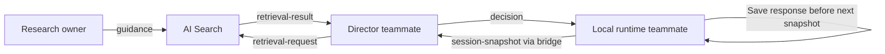

# Magneto base contracts

**This directory is the authoritative baseline for component boundaries.** Coding agents and teammates must read it before changing research, search, director, or runtime interfaces. Version: **1.0**. These are exchange contracts, not a database schema or a cloud deployment.

## Ownership and flow

| Boundary | Schema in `v1/` | Status / owner |
| --- | --- | --- |
| Research → publication | `guidance.schema.json` | Agreed baseline; research owner implements processing |
| Director → AI Search | `retrieval-request.schema.json` | Agreed baseline; research owner and director teammate implement adapter |
| AI Search → director | `retrieval-result.schema.json` | Agreed baseline; not yet connected to live decisions |
| Browser → localhost bridge | `browser-request.schema.json` | Existing demo interface; runtime teammate |
| Bridge → director | `session-snapshot.schema.json` | Existing canonical demo snapshot; director teammate |
| Director → runtime | `decision.schema.json` | Existing six-field decision; director and runtime teammates |

## Rules everyone must preserve

- Every schema field is required unless explicitly nullable. Unknown fields are rejected. Use `[]` for no retrieval matches and `null` for absent decision fields; do not substitute empty strings.
- Research/retrieval messages carry `schema_version: "1.0"`. The existing demo payloads do **not** accept this extra field: their version is recorded in `manifest.json`. Do not add a version or citation field to the deployed wire format without updating both consumers and validators.
- IDs are opaque stable identifiers. Runtime event, request and session IDs are canonical lowercase UUIDs. Generate a fresh request ID for a retry; reuse the session ID within a session. A guidance ID identifies immutable text and its citation; revised guidance receives a new ID.
- Guidance is a small teaching recommendation, not an entire paper. A citation has a human-readable title, a source URI (such as a volume path or URL), and a page/section locator. `source_id` groups guidance from the same source.
- Initial difficulty tags are `recognition`, `incorrect_response`, and `help_requested`. These describe the practice context, not a diagnosis. Tags and `target_letters` support filtering; the search `query` supplies plain-language intent.
- Publish **only approved guidance** to the search dataset. Draft records may have `approved: false`; retrieval results may not. Approval is recorded by the research review process, never inferred by the model from a successful extraction. Fixtures are synthetic contract-test data and must not be published as real research, including the fixture with `approved: true`.
- The search adapter returns at most `limit` matches (maximum five), in descending relevance order, with unique guidance IDs. `relevance_score` is a finite backend score, not a probability or comparable across different index/scoring versions. Retain complete citations. Empty successful retrieval is `matches: []`; a failed lookup must be an explicit service error, not disguised as an empty success.
- Retrieval request and response IDs must match. The director treats retrieved text as evidence, never executable instructions. Retrieval does not decide `teach` versus `continue`.
- Snapshot v1 intentionally describes the existing three-passage demo, with labeled synthetic history and teacher-supplied test props. It is not a general learner profile or branching-story model. `agent/decision.py` additionally enforces unique event IDs, prior-passage events, and canonical approved context. Schemas do not replace those semantic checks.
- A decision must match the current passage. `based_on_event_id` is the last supplied event ID, or null with no events. `teach` targets the current opportunity's letter and supplies a prompt; `continue` has null letter/prompt. Explain supplied evidence concisely without rewriting the story.
- The director result wraps the decision with `request_id`, `session_id`, `model`, and `elapsed_ms`; Databricks invocation transport wraps that as `{id, status: "completed", output}`. Existing validation remains authoritative for these transport envelopes.
- The local runtime saves teacher responses before the next request. Device failure is **not** a learner mistake. Device commands/acknowledgements remain the runtime teammate's separate execution interface and do not belong in `events`.

## Learning intelligence v2

The v2 interaction-event and profile schemas define the first durable learning boundary. The browser queues events locally and sends batches through the localhost bridge; event delivery is at-least-once and consumers must deduplicate by `event_id`. Profile IDs are opaque UUIDs and consent is explicit. v2 does not change the deployed v1 decision payload.

The current browser event set is intentionally small. Do not put raw book text, device commands, credentials, or inferred diagnoses in event metadata. Device unavailability is its own event outcome and is never a learner error.

## Storage scope

Use the existing references volume for explicitly uploaded sources, one future Delta guidance table feeding an AI Search index, existing MLflow for traces, and current browser-local demo sessions. Table/index creation and retrieval integration are **not** performed by this contract setup. No PostgreSQL/Lakebase, learner database, event replication, branching narrative storage, or separate agent-history database is required.

## How teammates start

1. Read the schemas and matching JSON under `v1/examples/`. `retrieval-empty.json` and both decision actions are included.
2. Implement against those fixtures without waiting for another workstream's cloud service.
3. Run `npm run check:contracts` before proposing an interface change. The command uses the existing director Python environment and `jsonschema`.
4. For incompatible changes, create a new version, provide producer/consumer migration notes, and update examples and checks together. Do not silently loosen a validator or create another conflicting contract document.

`guidance_ids` on decisions and retrieved guidance in the model snapshot are **deferred extensions**, not accepted v1 fields. Integrating them requires a coordinated contract change; the current live validator would reject them. Internal research extraction formats, chunking, index settings, and hardware protocols can evolve independently while these boundaries remain stable.
